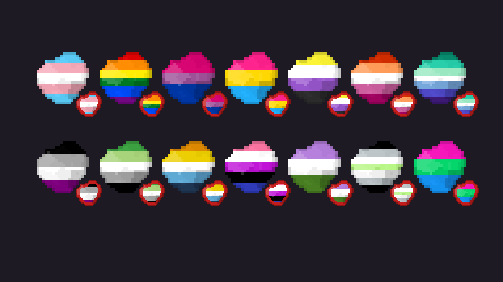

# Pride Gold

Noita mod that recolours gold with a pride flag.

Covers all the gold nuggets (including the idols and the statue), gold dust, molten gold and the gold icons. Blood money gets a red outline so you can still tell it apart. Pick the flag in Mod Settings, restart to apply.

Flags: trans, rainbow, bi, pan, non-binary, lesbian, gay (MLM), ace, aro, aroace, genderfluid, genderqueer, agender, polysexual.

To add a flag, add its stripe colours to `files/flags.lua` (top to bottom, repeat a colour to make it thicker) and add the id to the list in `settings.lua`.

Inspired by deathhancox's [Trans Gold](https://github.com/deathhancox/trans_gold) and Evaisa.
